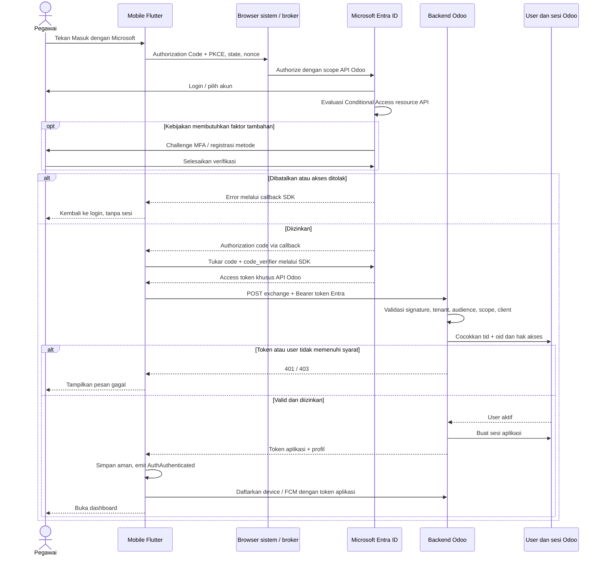

# Flow implementasi SSO Microsoft 365 + MFA — Entra ID → Odoo → Mobile

Status: rancangan implementasi, belum mengubah aplikasi atau konfigurasi tenant.
Tanggal: 23 Oktober 2026.

## 1. Keputusan implementasi

Gunakan akun Microsoft 365 melalui **Microsoft Entra ID**, dengan **Authorization Code + PKCE (S256)** di mobile. MFA diwajibkan melalui kebijakan Entra. SSO dan MFA saling melengkapi: SSO memakai identitas perusahaan, MFA memverifikasi pengguna dengan faktor tambahan sesuai kebijakan.

Mobile memperoleh access token khusus API Odoo, kemudian menukarnya dengan sesi aplikasi yang diterbitkan Odoo. Dengan demikian, fitur bisnis tetap menggunakan mekanisme autentikasi backend aplikasi. Password Microsoft hanya dimasukkan di halaman Microsoft; aplikasi dan Odoo tidak menerima password tersebut.

Asumsi: aplikasi Android/iOS Flutter, satu tenant perusahaan, backend Odoo dapat ditambah endpoint. Versi Odoo, modul autentikasi terpasang, dan kontrak sesi backend perlu diverifikasi tim backend sebelum coding. Endpoint dan nama konfigurasi di bawah merupakan usulan, bukan endpoint yang sudah tersedia.

Referensi protokol: [Authorization Code + PKCE](https://learn.microsoft.com/en-us/entra/identity-platform/v2-oauth2-auth-code-flow). Jangan menggunakan password grant/ROPC karena [tidak kompatibel dengan MFA](https://learn.microsoft.com/en-us/entra/identity-platform/v2-oauth-ropc).

## 2. Kondisi aplikasi saat ini

Alur yang ditemukan di repository:

```text
LoginSsoEvent
  → AuthBloc._onLoginSso
  → LoginUseCase.loginSso(email, password, ...)
  → AuthRepositoryImpl.loginSso
  → AuthRemoteDataSource.authenticate
  → AuthApi.loginOdoo(login, password, device, fcm_token)
  → Simpan user/token → registerDevice → AuthAuthenticated
```

Nama `loginSso` saat ini belum membuktikan integrasi Microsoft: implementasinya mengirim kredensial ke Odoo. `checkAuth()` hanya memeriksa keberadaan token dan user lokal. Repository juga memiliki fallback `odoo_session` saat token kosong; alur baru harus menolak respons tanpa kredensial sesi yang benar.

## 3. Konfigurasi Microsoft Entra ID

### A. Daftarkan resource API Odoo

1. Buka [Microsoft Entra admin center](https://entra.microsoft.com), pilih tenant perusahaan.
2. Masuk **Entra ID → App registrations → New registration**.
3. Nama contoh: `iOffice-Odoo-API`; pilih akun dalam direktori organisasi ini saja (single tenant).
4. Catat **Directory (tenant) ID** dan **Application (client) ID** API.
5. Di **Expose an API**, tetapkan Application ID URI `api://<ODOO_API_CLIENT_ID>`.
6. Tambah delegated scope `access_as_user`, aktifkan, gunakan persetujuan admin sesuai kebijakan perusahaan.
7. Untuk kontrak ini, konfigurasi API menerima access token v2 (`api.requestedAccessTokenVersion = 2`). Backend harus memvalidasi issuer/audience sesuai versi token tersebut.

Panduan: [Expose API scopes](https://learn.microsoft.com/en-us/entra/identity-platform/scenario-protected-web-api-expose-scopes).

### B. Daftarkan aplikasi mobile

1. Buat app registration `iOffice-Mobile`, single tenant.
2. Catat `MOBILE_CLIENT_ID`.
3. Di **Authentication → Add a platform**, daftarkan Android dan iOS sesuai SDK autentikasi yang dipilih. Android memakai package name dan signing certificate hash; iOS memakai bundle ID. Jika memakai pustaka OIDC generik, gunakan platform native/mobile dan redirect URI yang didukung pustaka tersebut.
4. Daftarkan redirect URI persis sama dengan konfigurasi aplikasi. Pastikan varian QA/production dan sertifikat signing masing-masing sesuai; gunakan registration terpisah bila diperlukan untuk isolasi.
5. Di **API permissions → Add a permission → My APIs**, pilih API Odoo → delegated permission `access_as_user`; admin memberikan consent sesuai kebijakan tenant.
6. Opsional: preauthorize client mobile di **Expose an API → Authorized client applications** pada API Odoo.
7. Jangan membuat atau menanam `client_secret` di APK/IPA. Native mobile adalah public client. Jangan mengaktifkan implicit grant atau password grant untuk alur ini.

Scope permintaan mobile:

```text
openid profile offline_access api://<ODOO_API_CLIENT_ID>/access_as_user
```

`offline_access` hanya diperlukan bila aplikasi membutuhkan pembaruan token Microsoft. Tidak diperlukan izin Microsoft Graph untuk sekadar masuk ke aplikasi ini.

Panduan: [Configure client API permissions](https://learn.microsoft.com/en-us/entra/identity-platform/quickstart-configure-app-access-web-apis).

### C. Wajibkan MFA

1. Pastikan lisensi pengguna mendukung kebijakan yang dipakai. Conditional Access memerlukan Entra ID P1/P2; jangan mengasumsikan setiap paket Microsoft 365 memilikinya.
2. Aktifkan metode autentikasi yang diizinkan organisasi, misalnya Microsoft Authenticator/passkey; pengguna mendaftarkan metode tersebut.
3. Buka **Entra ID → Conditional Access → Policies**, buat kebijakan untuk grup pilot.
4. Target resource **API Odoo**, bukan hanya nama client mobile. Pastikan enterprise application/service principal API tersedia dan dapat dipilih.
5. Pada **Grant**, wajibkan MFA atau authentication strength yang ditetapkan perusahaan.
6. Evaluasi dengan **Report-only**, periksa sign-in logs, kemudian aktifkan **On** untuk pilot. Report-only belum menegakkan MFA.
7. Setelah pengujian, perluas pengguna secara bertahap; kelola akun akses darurat sesuai kebijakan administrator.

Jika tidak tersedia Conditional Access, Security Defaults memberi proteksi dasar tenant, tetapi tidak memberikan kontrol MFA khusus aplikasi yang sama. MFA tidak selalu menampilkan challenge pada setiap login: sesi/faktor yang masih memenuhi kebijakan dapat digunakan kembali.

Referensi: [MFA Microsoft 365](https://learn.microsoft.com/en-us/microsoft-365/admin/security-and-compliance/set-up-multi-factor-authentication?view=o365-worldwide), [Security Defaults](https://learn.microsoft.com/en-us/entra/fundamentals/security-defaults), [Conditional Access target resources](https://learn.microsoft.com/en-us/entra/identity/conditional-access/concept-conditional-access-cloud-apps).

## 4. Konfigurasi dan implementasi backend Odoo

### A. Konfigurasi server

Simpan di konfigurasi deployment server atau parameter sistem terbatas, sesuai pola backend yang sudah ada:

| Parameter usulan | Nilai |
|---|---|
| `ENTRA_TENANT_ID` | Tenant perusahaan yang diizinkan |
| `ENTRA_API_CLIENT_ID` | Client ID resource API Odoo |
| `ENTRA_ALLOWED_MOBILE_CLIENT_ID` | Client ID mobile yang diizinkan |
| `ENTRA_REQUIRED_SCOPE` | `access_as_user` |
| `ENTRA_METADATA_URL` | `https://login.microsoftonline.com/<TENANT_ID>/v2.0/.well-known/openid-configuration` |
| `APP_SESSION_MAX_AGE` | Batas sesi aplikasi sesuai kebijakan keamanan |

Backend yang hanya memvalidasi access token tidak memerlukan client secret Microsoft. Jangan mengambil issuer/JWKS URL dari input pengguna; discovery harus berasal dari tenant yang sudah dikonfigurasi.

### B. Pemetaan identitas

Tambahkan mapping unik `(entra_tenant_id, entra_object_id)` → user Odoo/pegawai. Administrator menghubungkan akun melalui sumber data pegawai yang terverifikasi. Email/UPN dapat berubah dan tidak boleh menjadi satu-satunya dasar pengaitan otomatis. Tolak akun belum dipetakan, user nonaktif, serta akun yang tidak memiliki izin aplikasi. Role tetap berasal dari aturan akses Odoo.

### C. Endpoint pertukaran sesi

Usulan route: `POST /api/auth/microsoft/exchange`, HTTPS, tanpa sesi aplikasi sebelumnya. Tentukan tipe controller dan envelope JSON/JSON-RPC sesuai versi dan pola API Odoo; contoh berikut adalah kontrak HTTP JSON usulan.

```http
POST /api/auth/microsoft/exchange
Authorization: Bearer <ENTRA_ACCESS_TOKEN_FOR_ODOO_API>
Content-Type: application/json
```

```json
{
  "device_id": "<device-id>",
  "device_name": "<device-name>",
  "platform": "android",
  "app_version": "<version>"
}
```

Urutan validasi server:

1. Validasi format dan ukuran request; terapkan rate limit dan redaksi header/token pada log.
2. Gunakan pustaka JWT/OIDC yang tersedia dan terawat untuk validasi signature melalui JWKS tenant, algoritma yang diizinkan, `iss`, `aud`, `exp`, `nbf`, dan `tid`. Cache JWKS dengan dukungan rotasi key.
3. Untuk kontrak access token v2 ini, `aud` harus client ID API Odoo, `azp` harus client mobile yang diizinkan, dan `scp` harus memuat `access_as_user`. Tolak token app-only tanpa delegated scope.
4. Tolak ID token dan token Microsoft Graph sebagai kredensial API Odoo. Decode JWT saja bukan validasi.
5. Ambil `tid` dan `oid` dari token tervalidasi, cari mapping, periksa user aktif dan hak akses Odoo.
6. Terbitkan sesi aplikasi melalui mekanisme backend yang sudah ada. Jangan memanggil login password Odoo dengan password kosong, membuat password pengganti, atau memberi akses `sudo()` ke seluruh request.
7. Kembalikan profil dan kredensial sesi yang kompatibel dengan parser mobile. Adaptasi `LoginResponse` bila diperlukan; jangan mengasumsikan contoh di bawah langsung cocok dengan parser saat ini.

Contoh respons usulan:

```json
{
  "success": true,
  "access_token": "<ODOO_APP_ACCESS_TOKEN>",
  "expires_in": 900,
  "refresh_token": "<ODOO_APP_REFRESH_TOKEN>",
  "user": {"id": 123, "nama": "Nama Pegawai"}
}
```

TTL 900 detik hanya contoh. Refresh token aplikasi perlu rotasi, revokasi, penyimpanan aman di server, serta deteksi reuse sesuai mekanisme backend. Endpoint pertukaran menerima bearer token yang dapat digunakan kembali selama valid; jangan mengklaim token tersebut sekali pakai.

Referensi: [Access token validation](https://learn.microsoft.com/en-us/entra/identity-platform/access-tokens).

### D. Batas sesi dan MFA

Entra menegakkan MFA ketika menerbitkan token resource API. Jangan mengandalkan flag `mfa=true` dari mobile atau mewajibkan klaim `amr` selalu ada pada access token v2.

Sesi aplikasi Odoo yang diterbitkan setelahnya memiliki lifecycle sendiri: disable akun Microsoft atau perubahan kebijakan tidak otomatis mencabut sesi Odoo. Tetapkan batas absolut sesi; setelah batas tersebut, wajibkan token Entra baru dan evaluasi ulang kebijakan sebelum menerbitkan sesi baru. Pemeriksaan token JWT lama saja belum membuktikan akun Microsoft masih aktif. Untuk kebutuhan pencabutan segera, diperlukan rancangan sinkronisasi/revokasi tambahan yang disepakati tim backend dan administrator tenant.

Setelah SSO diwajibkan, blokir login password lama bagi akun yang sudah dimigrasikan di sisi backend. Menyembunyikan tombol password di mobile saja masih memungkinkan bypass MFA melalui endpoint lama.

## 5. Integrasi mobile Flutter

### A. Konfigurasi aplikasi

```text
ENTRA_TENANT_ID=<tenant-id>
ENTRA_MOBILE_CLIENT_ID=<mobile-client-id>
ENTRA_AUTHORITY=https://login.microsoftonline.com/<tenant-id>/v2.0
ENTRA_REDIRECT_URI=<registered-native-redirect-uri>
ENTRA_API_SCOPE=api://<odoo-api-client-id>/access_as_user
ODOO_BASE_URL=<https-backend-url>
```

Nilai ID/URI merupakan konfigurasi publik, bukan secret. Pilih satu pustaka autentikasi yang mendukung platform target: wrapper MSAL/native bila memerlukan broker/Conditional Access berbasis perangkat, atau pustaka OIDC/AppAuth dengan system browser untuk PKCE standar. Verifikasi dukungan dan pemeliharaan pustaka sebelum memilih versi; MFA saja tidak memerlukan penambahan layar OTP buatan aplikasi.

### B. Android dan iOS

- Android: cocokkan application ID, redirect intent filter/callback activity, serta signing hash debug/release dengan registration dan dokumentasi SDK. Uji versi release yang benar-benar didistribusikan.
- iOS: cocokkan bundle ID, URL callback scheme, dan pengaturan Keychain/broker yang diperlukan SDK. Uji callback saat aplikasi aktif maupun dimulai ulang.
- Gunakan browser sistem atau broker yang didukung, dengan validasi `state`, `nonce` OIDC, redirect URI, dan PKCE oleh pustaka. Hindari embedded WebView untuk login Microsoft.

### C. Perubahan minimum di repository

| Lokasi | Perubahan yang direncanakan |
|---|---|
| `lib/presentation/screens/login/login_plnEG.dart` | Tombol masuk Microsoft yang membuka login interaktif |
| `lib/presentation/bloc/auth/auth_bloc.dart` | Event login Microsoft → loading → pembatalan/error/berhasil |
| `lib/domain/usecases/login.dart` dan interface repository | Tambahkan jalur login Microsoft tanpa parameter password |
| `lib/data/repositories/auth_repository_impl.dart` | Tukar token Entra, validasi respons sesi, simpan user/token, gunakan registrasi device yang sudah ada |
| `lib/data/datasources/remote/auth_remote_ds.dart` | Metode exchange Microsoft terpisah dari autentikasi password |
| `lib/core/network/api/auth/auth_api.dart` dan `auth_endpoints.dart` | Route exchange baru; reuse HTTP client, tetapi pastikan interceptor tidak menimpa Authorization Entra dengan token Odoo lama |
| `lib/data/models/login_response.dart` | Cocokkan kontrak respons final backend |
| `lib/data/datasources/local/auth_local_ds.dart` | Simpan kredensial sesi di secure storage; hapus token lama dari preferences saat migrasi |
| `lib/config/di/injector.dart`, konfigurasi environment, Android/iOS | Wiring autentikasi, ID tenant/client, callback platform |

`flutter_secure_storage` sudah terpasang. Gunakan untuk token aplikasi; biarkan SDK mengelola cache token Microsoft dengan mekanisme aman yang didukung. Jangan meneruskan token Entra ke API bisnis lama sebagai pengganti token Odoo.

Sebelum rollout, hentikan pengiriman token mentah dari `DebugReportingService.pushToken` dan `reportApiError` ke Firestore; redaksi juga header Authorization, refresh token, dan payload autentikasi. Jalur login sekarang memanggil `pushToken`, sehingga reuse alur sukses harus menghilangkan pengiriman kredensial tersebut.

## 6. Flow utama



Urutan ringkas:

```text
Konfigurasi tenant + API scope + client mobile + kebijakan MFA
  → Mapping user di Odoo + endpoint validasi/token exchange
  → Mobile membuka Microsoft → MFA sesuai kebijakan
  → Token Entra khusus API → Odoo memvalidasi
  → Sesi Odoo → secure storage → register device → dashboard
```

## 7. Refresh, logout, dan kegagalan

- Aplikasi dibuka kembali: cache profil untuk tampilan awal, lalu verifikasi/refresh sesi ke backend. Token tersimpan saja tidak membuktikan sesi valid.
- API mengembalikan 401: refresh sesi aplikasi satu kali, retry request satu kali; cegah refresh paralel dan loop. Jika gagal atau batas absolut sesi tercapai, hapus sesi dan mulai login Microsoft lagi.
- SDK membutuhkan interaksi (`interaction_required`/claims challenge): jalankan login interaktif sesuai respons yang didukung SDK. Jangan otomatis kembali ke login password.
- Logout: cabut sesi/refresh token aplikasi di Odoo, hapus kredensial lokal serta registrasi FCM terkait, dan bersihkan akun/cache SDK sesuai perilaku logout yang dipilih. Logout aplikasi tidak otomatis mengakhiri seluruh sesi Microsoft 365 di browser/broker.
- Pengguna membatalkan login/MFA: kembali ke layar login tanpa menyimpan sesi parsial.
- Token salah audience/tenant/signature, kedaluwarsa: 401. Token valid tetapi user belum dipetakan, nonaktif, atau tidak punya izin: 403 dengan pesan aman.
- Microsoft/Odoo tidak tersedia: tampilkan pesan yang dapat dicoba ulang; jangan melewati MFA atau menerima token tanpa validasi.

## 8. Urutan pengerjaan dan kriteria selesai

| Tahap | Penanggung jawab | Hasil yang diverifikasi |
|---|---|---|
| 1 | Admin Microsoft | Tenant, dua app registration, redirect URI, delegated scope, consent, kebijakan pilot |
| 2 | Backend Odoo | Mapping user, validasi token, endpoint exchange, sesi/refresh/revokasi, penutupan bypass password |
| 3 | Mobile | SDK login, callback Android/iOS, exchange, secure storage, pemulihan sesi dan logout |
| 4 | QA + admin | Uji end-to-end dan bukti kebijakan MFA di Entra sign-in logs |
| 5 | Tim operasional | Pilot → perluasan; rollback terkontrol tanpa membuka bypass MFA pengguna wajib SSO |

Skenario penerimaan minimum:

- Akun perusahaan yang dipetakan berhasil masuk dan mengakses fitur sesuai role Odoo.
- MFA benar-benar ditegakkan pada resource API; challenge baru muncul ketika kebijakan memerlukannya.
- Tenant lain, personal account, ID token, token Graph, token rusak/kedaluwarsa, client tidak diizinkan, dan scope salah ditolak.
- User tidak dipetakan/nonaktif ditolak; email berubah tidak memutus mapping `tid + oid`.
- Callback Android/iOS release, cancel, timeout, koneksi putus, dan aplikasi dimulai ulang tertangani.
- Refresh/retry tidak berulang tanpa batas; token kosong tidak menjadi sesi `odoo_session`.
- Logout mencabut sesi Odoo; akun yang wajib SSO tidak bisa melewati MFA melalui login password lama.
- Token tidak muncul di log/Firestore; penyimpanan lokal dan migrasi cache lama diperiksa.
- Perubahan status akun Microsoft diuji terhadap batas sesi Odoo yang disepakati, bukan diasumsikan langsung tercabut.

## 9. Data yang perlu diisi sebelum implementasi

```text
Tenant ID:
API client ID:
Mobile client ID (QA / production):
Android package name dan signing hash:
iOS bundle ID:
Redirect URI per platform:
Base URL Odoo QA / production:
Versi Odoo dan pola controller/API:
Kontrak sesi/refresh/logout yang tersedia:
Sumber mapping tid + oid ke pegawai:
Grup pilot dan lisensi Conditional Access:
Batas absolut sesi aplikasi dan target waktu revokasi:
```

Dokumen ini merancang autentikasi mobile ke Odoo. SSO untuk halaman web/admin Odoo merupakan integrasi terpisah; pemasangan provider OAuth web saja belum menyediakan token exchange mobile di atas.
